 

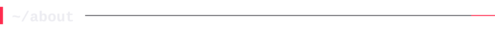

I'm Hossein, a frontend developer from Shahrekord, Iran, and a Computer Science student at Payame Noor University.

I build web interfaces with HTML, CSS and JavaScript, and I care about how they look and behave on every screen size. I'm still early in my modern frontend journey, so right now I'm strengthening my JavaScript fundamentals and learning by building small, practical projects before reaching for bigger tools.

 

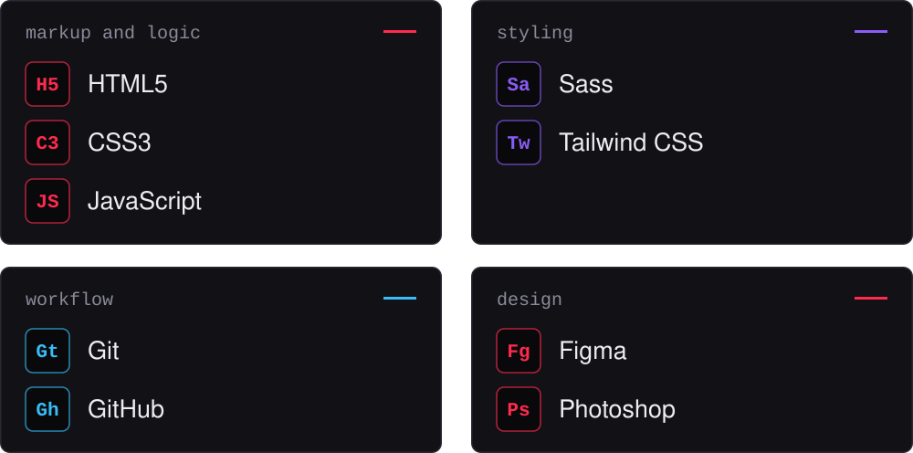

 

<a href="https://github.com/hossein-kohgard/tech-store">
  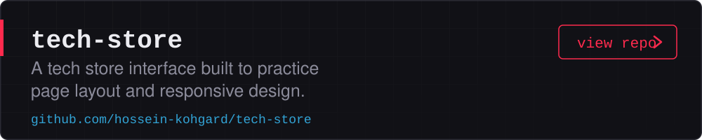
</a>

<a href="https://github.com/hossein-kohgard/guess-my-number">
  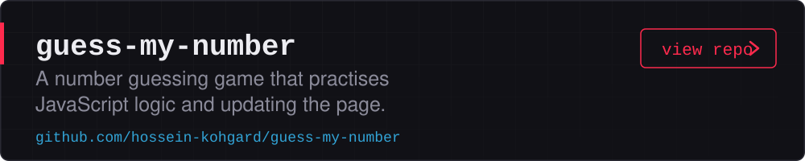
</a>

<a href="https://github.com/hossein-kohgard/profile-card">
  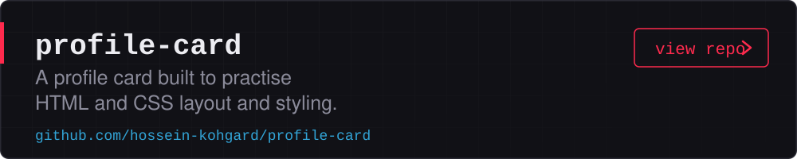
</a>

<a href="https://github.com/hossein-kohgard/excursion">
  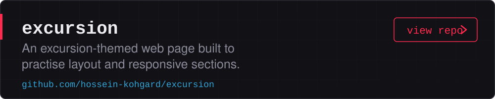
</a>

 


 

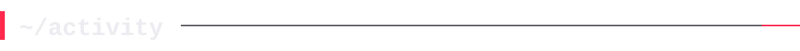

The commits are the record. Everything I've built so far is public in [my repositories](https://github.com/hossein-kohgard?tab=repositories), and the full contribution graph is on my [GitHub profile](https://github.com/hossein-kohgard).

 

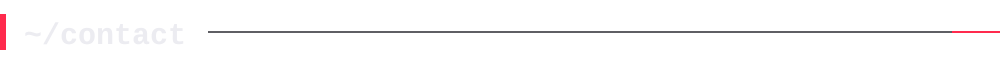

<a href="https://github.com/hossein-kohgard">
  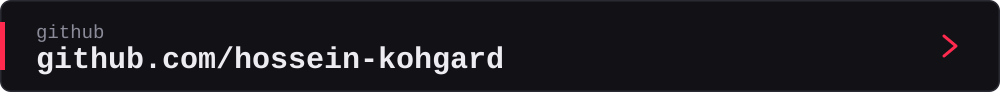
</a>

<a href="https://instagram.com/artcode.bot">
  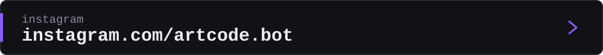
</a>

 

